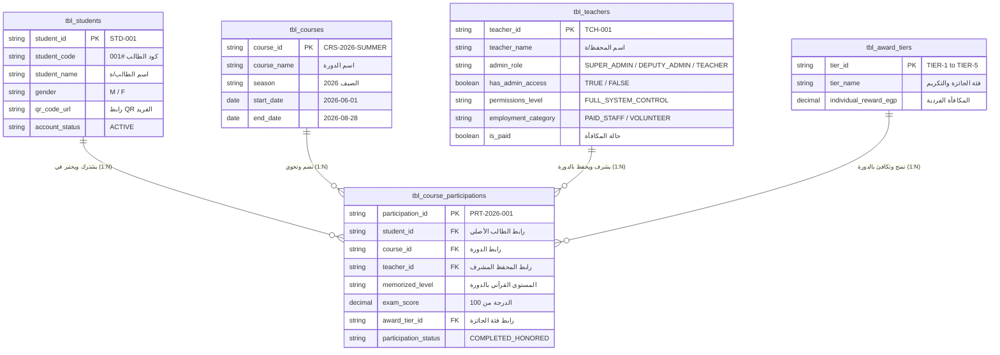

# 🗄️ توثيق وهيكلة قاعدة البيانات الموحدة لمنظومة كُتّاب (KUTTAB Master Relational Database Schema)

> **المسار الرئيسي لقاعدة البيانات (Master DB):** [`system/db/kuttab_master_database.xlsx`](file:///Users/mac/Desktop/Wathba/kuttab/system/db/kuttab_master_database.xlsx)  
> **مستند المصدر المباشر:** [`system/original_kuttab_data_inventory.xlsx`](file:///Users/mac/Desktop/Wathba/kuttab/system/original_kuttab_data_inventory.xlsx)

---

## 📐 1. مخطط العلاقات النمطية المعتمد (Third Normal Form - 3NF ERD)

تم إضافة **نظام الصلاحيات والأدوار الإدارية (`admin_role` & `permissions_level`)** للشيوخ والمشرفين لإتاحة متابعة التقرير والمراقبة البرمجية للمنظومة:

---

## 👑 2. جدول الأدوار الإدارية ومصفوفة الصلاحيات (Admin Roles & Permissions Matrix)

| الدور الإداري (`admin_role`) | المسمى التنفيذي بالعربي | المشرفون المحددون | نطاق الصلاحيات البرمجية (`permissions_level`) |
|---|---|---|---|
| **`SUPER_ADMIN`** | 👑 المشرف العام ومدير المنظومة | **الشيخ عبدالله حسن الديهى** | `FULL_SYSTEM_CONTROL`: التحكم التام في جميع أجزاء السيستم، تقارير جميع الطلاب والشيوخ، الميزانيات، وتعيين الصلاحيات. |
| **`DEPUTY_ADMIN`** | ⭐ المشرف الأكاديمي والتنفيذي | **الشيخ محمد الشعراوي الفوال** | `ACADEMIC_EXAM_CONTROL`: الإشراف التنفيذي الأكاديمي، متابعة قاعات الاختبارات، مراجعة درجات وتقارير الشيوخ والطلاب. |
| **`TEACHER`** | 📘 محفظ ومعلم دائم | طاقم المحفظين العاملين (16 محفظاً) | `GROUP_ONLY`: متابعة وتقييم مجموعة الطلاب المكلف بهم فقط، وتسجيل الحضور والغياب اليومي. |
| **`ASSISTANT`** | 🤝 معلم وطالب مساعد | المعلمون والطلاب المتطوعون (15 متطوعاً) | `ASSIST_ONLY`: صلاحيات مساعدة وتسميع للمجموعات المكلف بها دون تعديل في النتائج النهائية. |

---

## 🗄️ 3. جداول العلاقات والكيانات (Normalized Database Tables)

### 1️⃣ `tbl_teachers` (جدول المحفظين والشيوخ والأدوار الإدارية)
* `teacher_id` (PK): `TCH-001` إلى `TCH-033`.
* `admin_role`: تحديد المستوى الإداري (`SUPER_ADMIN`, `DEPUTY_ADMIN`, `TEACHER`, `ASSISTANT`).
* `has_admin_access`: قيمة منطقية لتفعيل لوحات التحكم والتصدير (`TRUE` / `FALSE`).
* `permissions_level`: المستوى الفعلي للتراخيص.
